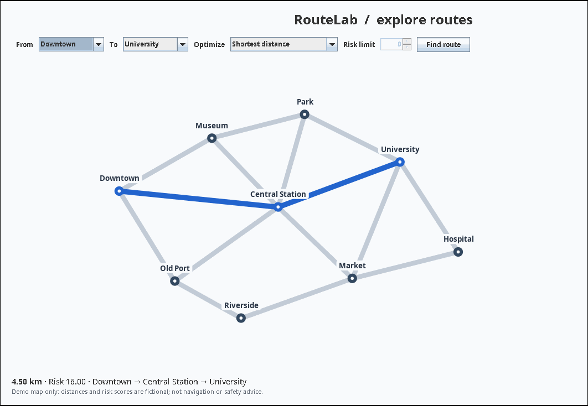

# RouteLab — Dijkstra Route Planner (Java)

A miniature, interactive route planner inspired by a **ConUHacks 9** route-finding project. Built in **Java 17+**, it models neighborhoods and roads as a weighted graph and lets you compare the shortest route, the lowest-risk route, and a distance-optimized route under a risk budget.



> **Project provenance:** This is a new, independent portfolio implementation based on the project idea described on my résumé. It is **not a recovered copy of the original hackathon submission**. The city, distances, and safety scores are fictional and must **not** be used for real-world navigation or safety decisions.

## Features

- **Dijkstra's algorithm** with a priority queue to find minimum-distance and minimum-risk paths.
- **LARAC-style constrained routing** using repeated Dijkstra searches with a Lagrangian penalty (`distance + λ × risk`). The method returns a path satisfying a specified risk budget if it finds one. It is **not guaranteed to find the global constrained optimum**.
- **Interactive Java Swing map** displaying roads, locations, and highlighted computed paths.
- **Command-line interface** for scripted routing and headless environments.
- **Automated tests** for shortest paths, safer alternatives, infeasible budgets, disconnected nodes, invalid weights, and the sample map.
- **GitHub Actions** continuous integration with Java 17.
- No third-party dependencies and no API keys.

## Quick start

You need **JDK 17 or later** (not just a Java Runtime Environment). Run these commands from the project folder:

```bash
# macOS / Linux
bash scripts/run.sh

# Run automated checks
bash scripts/test.sh
```

The first command opens a desktop window. Select an origin, a destination, and a route strategy. For **Distance within risk budget**, adjust the risk limit. Selected roads become blue.

### Try the CLI

```bash
bash scripts/run.sh --list
bash scripts/run.sh --from Downtown --to University --mode shortest
bash scripts/run.sh --from Downtown --to University --mode safest
bash scripts/run.sh --from Downtown --to University --mode balanced --risk-budget 6
bash scripts/run.sh --help
```

For locations containing spaces, quote the name, for example `--from "Central Station"`.

On Windows, compile from a **PowerShell** terminal with an installed JDK:

```powershell
New-Item -ItemType Directory -Force build/classes | Out-Null
$sources = Get-ChildItem src/main/java/com/qais/routeplanner -Filter *.java | ForEach-Object FullName
javac --release 17 -encoding UTF-8 -d build/classes $sources
java -cp build/classes com.qais.routeplanner.Main --gui
java -cp build/classes com.qais.routeplanner.Main --from Downtown --to University --mode shortest
```

## How it works

### 1. Graph representation

A `CityGraph` stores `Location` vertices and undirected `Road` edges. Each edge contains two nonnegative properties: distance (in illustrative kilometers) and risk (a synthetic, additive score).

### 2. Dijkstra

`RouteEngine` uses a binary min-heap (`PriorityQueue`) to repeatedly relax adjacent edges. The path is reconstructed from predecessor links. Time complexity is **O((V + E) log V)** with the priority queue in a connected graph; the implementation assumes nonnegative edge weights.

### 3. Two objectives and a constraint

| Mode | Objective |
|---|---|
| `shortest` | Minimize total `distanceKm` |
| `safest` | Minimize sum of fictional edge `risk` values |
| `balanced` | Find a short route whose total risk is ≤ the supplied budget |

For `balanced`, the algorithm first finds an unconstrained shortest path. If it exceeds the risk limit, it finds the minimum-risk path and checks feasibility. With one feasible and one infeasible path, it estimates a penalty coefficient λ and runs Dijkstra on `distance + λ × risk`, updating the candidate paths. This is a **LARAC-style Lagrangian relaxation approximation**, not exhaustive constrained-shortest-path optimization. Route decisions should be evaluated on additional graphs before claiming optimality.

### 4. Architecture

```text
src/main/java/com/qais/routeplanner/
  Main.java                  CLI & GUI entry point
  RoutePlannerWindow.java    Swing interface & controls
  MapPanel.java              Draws highlighted routes
  DemoCity.java              Fictional city and roads
  CityGraph.java             Graph storage
  Location.java              Vertex record
  Road.java                  Weighted edge record
  Route.java                 Result record
  RouteEngine.java           Dijkstra & constrained routing
src/test/java/com/qais/routeplanner/
  RouteEngineTest.java       Dependency-free tests
scripts/run.sh               Compile and run
scripts/test.sh              Compile and test
.github/workflows/java-ci.yml
```

## Design limitations

- **No geographic geocoding or live roads.** Locations are preloaded and fictional; there is no Google Maps integration.
- **Not real safety data.** “Risk” is only a demonstration score. Do not infer the actual safety of roads, areas, or travel modes from it.
- **LARAC is approximate.** Constrained shortest path can be more complex than standard Dijkstra; passing tests on small examples is not a general proof of optimality.
- **Undirected graph only.** One-way streets and turn restrictions are not modeled.

## Next improvements

- Import roads and vertices from CSV/GeoJSON data.
- Compare LARAC results against an exact constrained-path solver on small graphs.
- Add a route summary with edge-level distances and risk breakdowns.
- Add a real map tiles layer (subject to licensing and API terms).

## Author

**Qais Alasmar** — [GitHub](https://github.com/Qaisasmarr) · Computer Science, Concordia University
